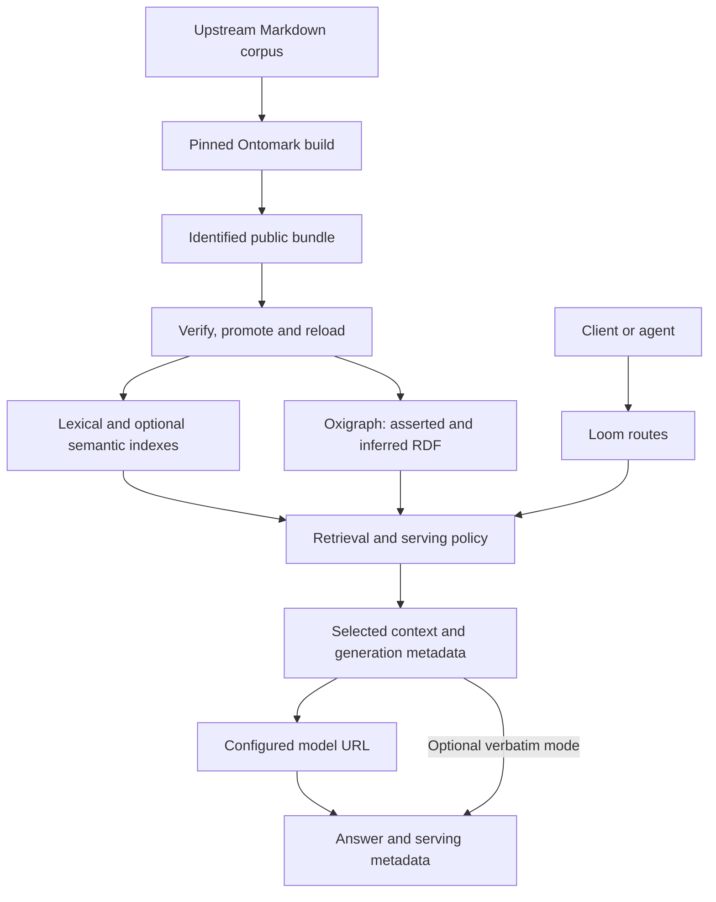

<div align="center">

# Ontology Loom

### Corpus grounding behind a model-swappable serving interface

**Retrieve a checked corpus slice, supply it to a model, and inspect which generation and serving policy were used.**

[Start](#quickstart) · [API](#use-the-serving-interface) · [Architecture](#how-it-works) · [Research](#what-the-measurements-establish) · [Status](#working-status) · [Docs](docs/README.md)

</div>

Loom is a Rust serving node for a published ontology generation. It provides bounded retrieval, read-only SPARQL, an agent tool interface and an OpenAI-compatible completion route. The model backend is configured by URL, independently of the corpus. A request can receive selected context, a canonical verbatim response, or a passthrough model response according to configuration and per-request options.

Use it to ground an assistant in a curated vocabulary, inspect relationships without a model, compare serving policies, or give a tool-using agent access to the same published generation. Formal checks concern the producer's supported logical profile; they do not establish that the corpus's assertions or a generated answer are factually correct.

## Quickstart

Clone the repository and inspect its build requirements before compiling. The workspace declares Rust 1.89; the [task runner](justfile) defines the feature-plane and dependency checks. Some adapters use sibling source dependencies: consult [`Cargo.toml`](Cargo.toml) and the [build architecture](docs/design/RUST-ARCHITECTURE.md) rather than treating this as a self-contained `cargo install` package.

```sh
git clone https://github.com/DreamLab-AI/loom.git
cd loom
just --list
just build
just test
```

`just ci` additionally runs formatting, strict Clippy and dependency-policy checks. These commands are the verification procedure, not a claim that this README refresh reran the whole workspace.

A useful server needs a **complete corpus bundle**, not just a reachable model. Follow [published-generation reload](docs/published-generation-reload.md) and [the publishing decision](docs/design/ADR-142-consume-versioned-shared-ontology-contracts.md) to build, promote and verify the intended generation. The compose profiles mount **repository-root `data/`** read-only at `/app/data`.

<details>
<summary><strong>Deployment profiles and the legacy mirror trap</strong></summary>

[`deploy/compose.profile-a.yml`](deploy/compose.profile-a.yml) describes a model-colocated deployment on port 8084; [`deploy/compose.profile-b.yml`](deploy/compose.profile-b.yml) describes a GPU-free sidecar on `visionclaw_network`, port 8080. The sidecar delegates to a separately configured model service. Run Docker builds and bind-mounted deployments on the deployment host: bind paths resolve there, not inside an agent container.

The retained [`app/mirror.sh`](app/mirror.sh) writes its four-file mirror to **`app/data/`**, which neither compose profile mounts as its corpus directory. It is also insufficient for the newer strict reload path, which requires six artefacts and the corresponding marker, digests and semantic-generation metadata. Copying four files into root `data/` is not a complete promotion procedure.

Use the current promotion/reload runbook. Inspect the loaded generation and index readiness after activation. A 200 response from `/health` can coexist with missing corpus data; liveness alone does not establish usable grounding. Keep the prior verified generation for rollback.

</details>

## Use the serving interface

Assuming the port-8084 profile is configured and has loaded a corpus:

```sh
# Retrieval only: no model call.
curl -fsS http://localhost:8084/loom/scaffold \
  -H 'Content-Type: application/json' \
  -d '{"prompt":"what is a rollup?","budget_tokens":700}'

# Retrieve, then delegate to the configured backend.
curl -fsS http://localhost:8084/v1/chat/completions \
  -H 'Content-Type: application/json' \
  -d '{"messages":[{"role":"user","content":"what is a rollup?"}],"max_tokens":1536}'

# For a subject outside this corpus: explicit model passthrough.
curl -fsS http://localhost:8084/v1/chat/completions \
  -H 'Content-Type: application/json' \
  -d '{"messages":[{"role":"user","content":"Explain this code review."}],"max_tokens":1536,"loom_options":{"scaffold":false}}'
```

The last example supplies no review content; add the material you want the backend to consider. Passthrough deliberately performs no corpus retrieval and reports `corpus_backed: false`. A model response through the Loom URL is therefore not automatically a grounded response.

| Endpoint | Purpose | Model needed |
|---|---|---|
| `GET /health` | Liveness, loaded generation, graph/index/backend readiness and policy | No |
| `GET /loom/generation` | Identity of the generation being served | No |
| `POST /loom/scaffold` | Budget-clamped retrieval/context assembly | No |
| `POST /loom/search` | Store search | No |
| `POST /loom/sparql` | Read-only, bounded query | No |
| `POST /mcp` | Streamable HTTP tools: manifest, browse, resolve, SPARQL, neighbours and paths | No |
| `POST /v1/chat/completions` | Context injection, optional verbatim serving or passthrough | For delegated generation |
| `GET /v1/models` | Backend model discovery | Backend required |
| `/loom/attest` and `/loom/attest/verify` | Feature-dependent attestation ledger and chain verification | No |

An attestation entry and a rehashed ledger are not proof that a model answer is true or that the whole estate's governance loop is complete. Read the route and signer contract before integrating that optional surface.

## How it works



Shared producer contracts give readers compatible scaffold/prose structures without making Loom an ontology compiler. Runtime stores and indexes are rebuildable serving projections. The [crate architecture](docs/design/RUST-ARCHITECTURE.md) separates domain types, adapters, scaffold policy, façade and benchmark tooling. The current workspace also includes `loom-bench`; the older eight-crate badge is no longer a complete census.

<details>
<summary><strong>Confidence, optional serving controls and per-request policy</strong></summary>

Retrieval confidence is a score-derived policy signal, not a calibrated probability of truth. Scores are comparable only within the reported scale. The `grounding` block records whether selection was full, scaled, skipped, verbatim or passthrough and exposes the relevant budget/seed information.

- `LOOM_CONFIDENCE_INJECTION` enables score-based selective injection. Strong and minimum-match thresholds and the minimum budget fraction are configured independently. Inspect the selected compose profile and `/health`; defaults and deployed values differ.
- `LOOM_VERBATIM_MODE` can return a canonical block without calling the backend.
- Exposure telemetry reports what was delivered or dropped; `LOOM_EXPOSURE_APPEND` optionally adds a coverage line.
- `LOOM_BACKEND_NO_THINK` and thinking-token controls affect delegated generation on their configured paths.
- `loom_options.verbatim=false` declines verbatim serving while retaining scaffold processing. `loom_options.scaffold=false` bypasses retrieval, injection, verbatim and associated thinking controls for that request.

See [confidence surfacing](docs/design/ADR-138-confidence-surfacing-contract.md), [scaffold opt-out](docs/design/ADR-139-per-request-scaffold-opt-out.md) and [the benchmark protocol](bench/UPLIFT-BENCH-PROTOCOL.md). Backend compatibility and available models still need checking when the configured URL changes.

</details>

## What the measurements establish

Loom's experiments measure retrieval and answer behaviour on identified corpus snapshots. They support faithful delivery of curated facts under the tested policies; a headline recall gain does not by itself establish reasoning, precision, attribution accuracy or transfer to another corpus.

The [research index](docs/research/README.md) identifies the current manuscript and superseded versions. Its copy-control analysis distinguishes facts already exposed in context from recovered answers. Preserve that control when quoting the older approximately 0.94 grounded-recall figures; they are not a guarantee for arbitrary models or queries.

<details>
<summary><strong>October pilot: injection versus tool traversal</strong></summary>

The [13 October pilot](docs/research/p1-pilot/RESULT.md) compared two arms on 40 preregistered questions using one generation. Lookup recall was similar, with substantially higher token and latency costs for tools. The path stratum favoured tools, but its gold came from the path tool and the injection arm often hit its output cap. The pooled confidence interval included zero. This pilot does not establish a general routing rule or universal tool-use advantage.

The [preregistration](bench/p1-pilot/PREREGISTRATION.md), raw results and scoring record make the limits inspectable. `loom-bench` is the new evaluation component since the previous README update; its existence is not a new production-grounding guarantee.

</details>

## Working status

**Source reviewed 21 October 2026 at `e2e4273`.** The source includes lexical retrieval, native SPARQL, the serving routes, the MCP plane and strict generation-reload tooling. Optional semantic fallback remains gated in the reference configurations. Activation is deployment-specific.

The [ADR-142 receipt](docs/design/ADR-142-consume-versioned-shared-ontology-contracts.md) records a first served Ontomark bundle on **12 October 2026**, generation `visionGraph@45976a8c…`, with verified identity and health observations. That replaces the earlier claim that first promotion was still pending. It is dated evidence, not a probe of today's server. [`deploy/ontomark-release.env`](deploy/ontomark-release.env) remains a separate, older publishing CLI pin and must not be read as the version embedded by every consumer.

No live deployment, fresh full workspace test, recall benchmark or model-to-model parity run was performed for this README refresh. A new backend, corpus or profile requires its own acceptance evidence. The node serves the public generation; private working notes and ontology promotion belong to their owning systems.

## Where it sits in VisionFlow

| Project | Relationship |
|---|---|
| [VisionFlow](https://github.com/DreamLab-AI/VisionFlow) | Architecture, cross-estate compatibility and status |
| [Ontomark](https://github.com/DreamLab-AI/ontomark) | Shared producer and typed bundle contracts |
| [knowledgeGraph](https://github.com/DreamLab-AI/knowledgeGraph) | Public corpus distribution; its retained archive differs from current publication |
| [Agentbox](https://github.com/DreamLab-AI/agentbox) | Configured agent/CLI clients and product-specific integration |
| [VisionClaw](https://github.com/DreamLab-AI/VisionClaw) | Knowledge application and governed write paths; independently loaded projections |

Loom assembles context. It does not grant an agent permission to change the ontology or sign a human decision, and it does not own every consumer's deployment.

## Documentation and licence

[Docs hub](docs/README.md) · [Reload runbook](docs/published-generation-reload.md) · [Research evidence](docs/research/README.md) · [Architecture](docs/design/RUST-ARCHITECTURE.md) · [Remote clients](docs/REMOTE-CLIENT-SETUP.md)

Code is **MIT OR Apache-2.0**: [MIT](LICENSE-MIT), [Apache](LICENSE-APACHE). Corpus/data and third-party terms are separate; consult the producer's notices. Maintained by [DreamLab AI](https://www.dreamlab-ai.com/) and [John O'Hare](https://github.com/jjohare).
